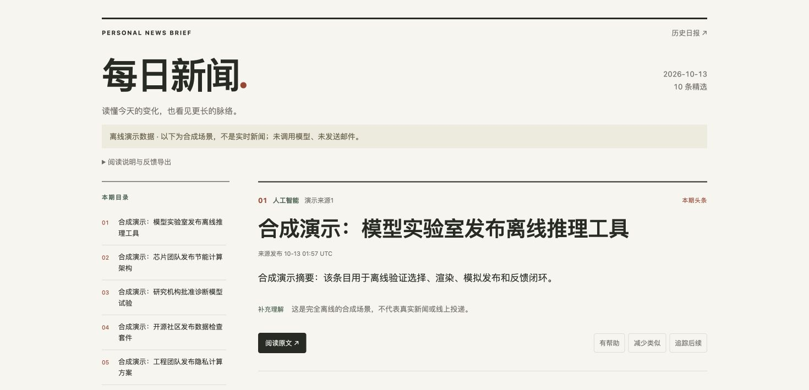

# Personal News Assistant

个人新闻助手的独立展示版本：采集 RSS、整理中文摘要，生成网页与邮件预览，并记录阅读反馈。

使用 AI 辅助开发。项目仍处于个人实践阶段，新闻筛选质量与长期使用效果尚未完成验证。

## 本地演示

需要 Python 3.12+、[uv](https://docs.astral.sh/uv/getting-started/installation/)；测试还需要 Node.js 以运行浏览器脚本用例。

```bash
uv sync --locked
uv run news-assistant demo --output work/demo
python3 -m http.server 8765 --bind 127.0.0.1 --directory work/demo/public
```

打开 [本地演示](http://127.0.0.1:8765)。安装依赖需要网络；演示使用合成新闻，不访问真实来源、不调用模型、不发送邮件。重复演示请使用新的空目录，例如 `work/demo-2`，避免覆盖已有结果。



## 可以查看的流程

| 环节 | 实现 |
| --- | --- |
| 收集 | RSS 解析、链接规范化、时间窗口与来源状态检查 |
| 整理 | 中文摘要接口、失败降级、去重与选择 |
| 阅读 | 日期页、历史页、原文链接、网页反馈与邮件 HTML |
| 反馈 | 浏览器导出，导入时核对事件版本，重复导入去重 |
| 发布状态 | 通过页面字节哈希匹配模拟投递，结果不明时不推断成功 |

演示包含两轮构建和程序模拟反馈。反馈进入影子评估，不自动改变 legacy 正式选文，也不能据此证明推荐更准确。浏览器中的反馈与演示生成的模拟反馈是分别存储的。

## 代码结构

- `src/news_assistant/`：采集、选择、渲染、反馈与状态管理。
- `tests/`：确定性回归、模拟 HTTP 和浏览器脚本测试。
- `experiments/`：事件选择 v2–v4、写作审核、本地处理流程等隔离实验。部分旧实验入口依赖未公开的历史语料；公开测试使用合成输入。
- `examples/workflows/`：部署工作流参考，不在本仓库自动执行。

```bash
uv run pytest -q
uv run ruff check .
```

[验证记录](docs/verification.md) · [设计与限制](docs/architecture.md) · [数据说明](SECURITY.md)

## 展示范围

此版本不包含原 Git 历史、真实日报语料、阅读反馈、私人偏好、运行状态或凭据。默认偏好使用等权重。原私有部署及其定时任务保持独立。

真实来源采集、模型摘要和邮件发送需使用者另行配置与授权；不要把 `build` 或 `send-email` 当作离线演示命令。模型调用可能产生费用。本仓库只启用测试 CI，不自动发布日报或发送邮件。

当前为公开展示版本，暂未附开源许可证。
